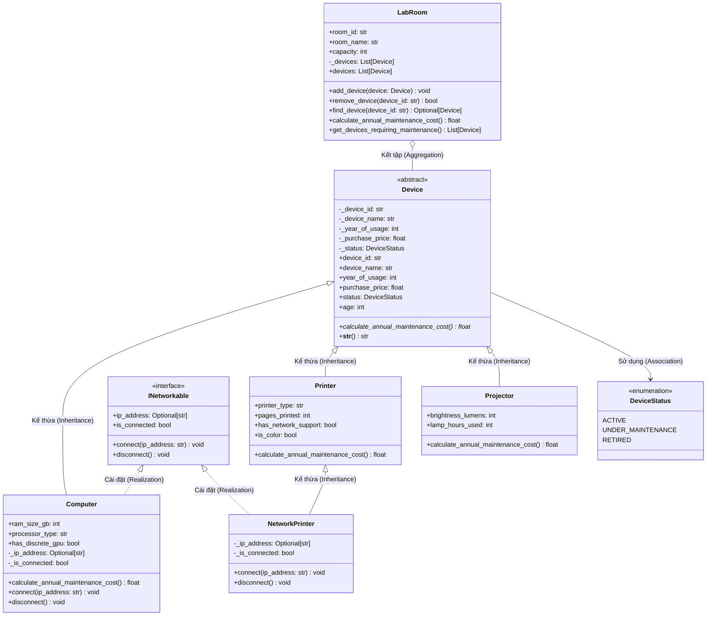

# BÁO CÁO THỰC HÀNH TUẦN 05 (LAB W05)
## CHỦ ĐỀ: HỆ THỐNG QUẢN LÝ THIẾT BỊ VÀ HỢP ĐỒNG BẢO TRÌ

---

### THÔNG TIN CHUNG
- **Mã sinh viên:** 202418872
- **Họ và tên:** Nguyễn Minh Đức
- **Môn học:** Lập trình hướng đối tượng (OOP)
- **Học kỳ:** 2026.1
- **Kho lưu trữ GitHub (Mã nguồn):** [https://github.com/ngminhduc129/Bai05](https://github.com/ngminhduc129/Bai05)
- **Tệp mã nguồn chính:** `main.py`

---

## 1. PHÂN TÍCH YÊU CẦU NGHIỆP VỤ

### 1.1. Bối cảnh bài toán
Một trường đại học cần xây dựng hệ thống quản lý trang thiết bị phục vụ các phòng thực hành tin học. Hệ thống giải quyết các bài toán nghiệp vụ sau:
1. **Quản lý danh mục thiết bị:** Theo dõi các thông tin định danh, cấu hình và trạng thái hoạt động của từng loại thiết bị.
2. **Dự toán chi phí bảo trì hàng năm:** Mỗi loại thiết bị có đặc thù vận hành và linh kiện hao mòn khác nhau, dẫn tới công thức tính chi phí bảo trì dự kiến khác nhau.
3. **Quản lý kết nối mạng linh hoạt:** Một số thiết bị có năng lực kết nối mạng (máy tính luôn có mạng, một số máy in hỗ trợ mạng, máy chiếu không có mạng). Hệ thống cần quản lý trạng thái online/offline, cấp phát IP mà không làm phức tạp hóa cây kế thừa chung.
4. **Quản lý phòng thực hành (LabRoom):** Phân bổ thiết bị vào các phòng, kiểm tra trùng lặp mã thiết bị, tổng hợp chi phí bảo trì phòng và lọc các thiết bị cần đưa đi bảo dưỡng.

### 1.2. Quy tắc nghiệp vụ chi tiết

#### A. Thiết bị chung (Device)
- **Mã thiết bị (`device_id`):** Định danh duy nhất, không được để trống, chỉ được thiết lập 1 lần khi khởi tạo (read-only).
- **Giá mua (`purchase_price`):** Phải là số dương (> 0).
- **Năm đưa vào sử dụng (`year_of_usage`):** Không được lớn hơn năm hiện tại.
- **Trạng thái hoạt động (`DeviceStatus`):** `Active` (đang hoạt động), `UnderMaintenance` (đang bảo trì), `Retired` (đã thanh lý).

#### B. Các loại thiết bị chuyên biệt
1. **Máy tính (Computer):**
   - Bổ sung thông tin: Dung lượng RAM (GB), loại vi xử lý (CPU), có GPU rời hay không.
   - Năng lực: Luôn có khả năng kết nối mạng (`INetworkable`).
   - Công thức chi phí bảo trì:
     $$\text{Chi phí} = \text{Giá mua} \times 5\% + (\text{Giá mua} \times 2\% \text{ nếu có GPU rời}) + (\text{Giá mua} \times 1\% \text{ nếu tuổi thọ } > 5 \text{ năm})$$

2. **Máy in (Printer / NetworkPrinter):**
   - Bổ sung thông tin: Loại máy in (`laser` hoặc `phun`), số trang đã in (`pages_printed`), có hỗ trợ cổng mạng (`has_network_support`), chế độ in màu (`is_color`).
   - *Lý do bổ sung thuộc tính `is_color`:* Đề bài yêu cầu cộng thêm 300.000 VNĐ nếu là máy in màu. Trong thực tế, máy in màu sử dụng 4 hộp mực (CMYK) và cụm sấy/đầu phun phức tạp hơn máy in đơn sắc, do đó chi phí bảo dưỡng định kỳ cao hơn rõ rệt.
   - Công thức chi phí bảo trì:
     $$\text{Chi phí} = (\text{Giá mua} \times 4\%) + (500.000 \text{ VNĐ nếu } \text{pages\_printed} > 100.000) + (300.000 \text{ VNĐ nếu là máy in màu})$$
   - Mô hình hóa mạng: Tách riêng lớp `NetworkPrinter` kế thừa từ `Printer` và thực thi interface `INetworkable`.

3. **Máy chiếu (Projector):**
   - Bổ sung thông tin: Độ sáng (`brightness_lumens`), số giờ đã sử dụng bóng đèn (`lamp_hours_used`).
   - Phiên bản hiện tại không có yêu cầu kết nối mạng.
   - Công thức chi phí bảo trì:
     $$\text{Chi phí} = (\text{Giá mua} \times 3\%) + (1.500.000 \text{ VNĐ nếu } \text{lamp\_hours\_used} > 3.000 \text{ giờ})$$

#### C. Năng lực kết nối mạng (INetworkable)
- Địa chỉ IP không được rỗng hoặc chứa khoảng trắng.
- Khi đang kết nối (`is_connected = True`), không được phép kết nối lại (ném ngoại lệ).
- Sau khi ngắt kết nối (`disconnect()`), `is_connected` trả về `False` và `ip_address` trả về `None`.

#### D. Phòng thực hành (LabRoom)
- Quan hệ với `Device`: **Kết tập (Aggregation)**.
- Ràng buộc:
  - Không thêm 2 thiết bị có cùng mã vào cùng một phòng.
  - Không chấp nhận đối tượng thiết bị `None`.
  - Tính tổng chi phí bảo trì phòng phải sử dụng tính **Đa hình** (duyệt danh sách và gọi phương thức ảo, không dùng `if/isinstance`).
  - Lọc thiết bị cần bảo dưỡng: Thiết bị đang ở trạng thái `UnderMaintenance` HOẶC có thời gian sử dụng trên 5 năm.

---

## 2. DANH SÁCH LỚP VÀ SƠ ĐỒ QUAN HỆ

### 2.1. Danh sách các thực thể trong hệ thống

| Tên lớp / Interface | Loại | Mô tả trách nhiệm |
|---|---|---|
| `DeviceStatus` | Enum | Định nghĩa 3 trạng thái của thiết bị: `ACTIVE`, `UNDER_MAINTENANCE`, `RETIRED`. |
| `Device` | Abstract Class | Lớp cơ sở trừu tượng chứa các thuộc tính chung (`device_id`, `device_name`, `year_of_usage`, `purchase_price`, `status`) và phương thức trừu tượng `calculate_annual_maintenance_cost()`. |
| `INetworkable` | Interface (ABC) | Định nghĩa giao thức kết nối mạng (`connect`, `disconnect`, `ip_address`, `is_connected`). |
| `Computer` | Concrete Class | Kế thừa `Device` và thực thi `INetworkable`. Đại diện cho máy tính để bàn/trạm. |
| `Printer` | Concrete Class | Kế thừa `Device`. Đại diện cho máy in thông thường (cổng USB). |
| `NetworkPrinter` | Concrete Class | Kế thừa `Printer` và thực thi `INetworkable`. Đại diện cho máy in mạng văn phòng. |
| `Projector` | Concrete Class | Kế thừa `Device`. Đại diện cho máy chiếu phòng học. |
| `LabRoom` | Container Class | Biểu diễn phòng thực hành, kết tập danh sách `Device`, quản lý thêm/xóa/tìm kiếm, tính tổng chi phí và lọc bảo trì. |

### 2.2. Sơ đồ quan hệ lớp (Class Diagram)



---

## 3. TRẢ LỜI CÁC CÂU HỎI THIẾT KẾ & LÝ THUYẾT

### 3.1. Vì sao `Device` là lớp trừu tượng?
1. **Bản chất nghiệp vụ:** Trong thực tế, không có một thực thể vật lý nào chỉ mang tên "thiết bị chung chung". Mọi thiết bị được mua về đều là một đối tượng cụ thể (máy tính Dell, máy in HP, máy chiếu Panasonic,...). Do đó, việc khởi tạo một instance `Device()` trực tiếp là không có ý nghĩa thực tế. Khai báo `Device` là lớp trừu tượng (Abstract Class) nhằm ngăn chặn việc tạo đối tượng vô nghĩa này.
2. **Bản chất kỹ thuật (Polymorphic Foundation):** Mỗi loại thiết bị có công thức tính chi phí bảo trì hoàn toàn khác nhau (máy tính theo GPU và tuổi đời; máy in theo số trang và chế độ in màu; máy chiếu theo tuổi thọ bóng đèn). Ở lớp cha `Device`, không thể cài đặt một công thức tính chung. Việc đặt `calculate_annual_maintenance_cost()` là phương thức thuần ảo (`@abstractmethod`) vừa chuẩn hóa giao diện lập trình bắt buộc các lớp con phải triển khai, vừa tạo nền tảng cho cơ chế đa hình khi gọi từ `LabRoom`.

### 3.2. Vì sao `INetworkable` là interface?
1. **Phân tách khả năng (Capability) khỏi bản chất thực thể (Identity):** Bản chất của một máy tính hay máy in là "thiết bị" (`is-a Device`). Tuy nhiên, "khả năng kết nối mạng" không phải là một loại thiết bị, mà là một **năng lực hành vi** (capability / behavior). 
2. **Tuân thủ nguyên lý phân tách giao diện (ISP - Interface Segregation Principle):** Nếu đưa các thuộc tính mạng (`ip_address`, `connect()`, `disconnect()`) vào lớp cha `Device`, các thiết bị không có mạng như `Projector` hoặc máy in đời cũ sẽ bị ép phải kế thừa các phương thức không dùng tới (gây mã thừa hoặc ném `NotImplementedError`).
3. **Tính tái sử dụng đa hình độc lập cây kế thừa:** Interface cho phép các lớp thuộc các nhánh kế thừa hoàn toàn khác nhau (ví dụ: `Computer`, `NetworkPrinter`, hoặc trong tương lai là `SmartAirConditioner`, `SecurityCamera`) cùng chia sẻ một giao thức mạng chuẩn hóa. Chương trình quản lý mạng chỉ cần làm việc với kiểu `INetworkable` mà không cần quan tâm thiết bị đó là gì.

### 3.3. Tính đa hình được thể hiện ở đâu trong hệ thống?
Tính đa hình (Polymorphism) được thể hiện tại 3 điểm trọng yếu:
1. **Đa hình trong tính chi phí bảo trì (`LabRoom.calculate_annual_maintenance_cost`):**
   - Vòng lặp tính toán:
     ```python
     for device in self._devices:
         total_cost += device.calculate_annual_maintenance_cost()
     ```
   - Tại thời điểm biên dịch / viết code, `device` chỉ được biết đến dưới dạng tham chiếu của lớp cơ sở trừu tượng `Device`. Nhưng tại thời điểm thực thi (Runtime Dynamic Dispatch), Python tự động gọi chính xác phương thức tính chi phí tương ứng của `Computer`, `Printer`, hoặc `Projector`. Mã nguồn hoàn toàn không cần bất kỳ câu lệnh `if-elif` hay kiểm tra kiểu nào, tuân thủ hoàn hảo nguyên lý Mở/Đóng (OCP).
2. **Đa hình thông qua Interface (`INetworkable`):**
   - Trong thao tác quản trị mạng, hệ thống lọc danh sách các thiết bị hỗ trợ mạng:
     ```python
     for net_dev in networkable_devices:
         net_dev.connect(ip)
     ```
   - `net_dev` có thể là một chiếc máy tính (`Computer`) hoặc một chiếc máy in mạng (`NetworkPrinter`). Chúng có cơ chế lưu trữ và cấu hình khác nhau, nhưng đều phản hồi cùng một thông điệp `connect()` và `disconnect()`.
3. **Đa hình thông qua ghi đè chuỗi hiển thị (`__str__`):**
   - Khi in thông tin thiết bị (`print(device)`), hàm `__str__` của từng lớp con được kích hoạt linh hoạt để bổ sung các thông số đặc thù (RAM, CPU, bóng đèn, số trang) vào chuỗi thông tin chung của lớp cha.

### 3.4. Quan hệ giữa `LabRoom` và `Device` là kết tập hay hợp thành?
- **Kết luận:** Mối quan hệ giữa `LabRoom` và `Device` là quan hệ **KẾT TẬP (Aggregation)**, KHÔNG PHẢI là hợp thành (Composition).
- **Giải thích dựa trên vòng đời:**
  - Trong quan hệ **Hợp thành (Composition)**, đối tượng thành phần (Part) phụ thuộc sinh tử vào đối tượng toàn thể (Whole). Nếu Whole bị hủy, Part cũng bị tiêu hủy theo.
  - Trong nghiệp vụ quản lý thiết bị trường đại học:
    + Một thiết bị có thể được mua về và nhập kho lưu trữ trước khi phân bổ vào bất kỳ phòng thực hành nào.
    + Một thiết bị có thể được chuyển từ phòng thực hành này (`LAB-101`) sang phòng khác (`LAB-102`).
    + Nếu một phòng thực hành bị giải thể, đổi mục đích sử dụng hoặc xóa khỏi phần mềm, các thiết bị bên trong không hề bị phá hủy hay xóa bỏ, mà tiếp tục tồn tại để tái phân bổ hoặc thanh lý.
    + Do đó, vòng đời của `Device` hoàn toàn độc lập với vòng đời của `LabRoom`.

### 3.5. Phân tích Trade-off: Lựa chọn mô hình cho máy in có mạng
- **Phương án đã chọn:** Tách lớp `NetworkPrinter` kế thừa từ `Printer` và thực thi interface `INetworkable`.
- **Đoạn phân tích trade-off (4 câu):**
  1. Việc tạo lớp `NetworkPrinter` kế thừa từ `Printer` và implement `INetworkable` phân định rành mạch giữa dòng máy in phổ thông kết nối qua USB và dòng máy in công nghiệp có card mạng riêng biệt, tuân thủ nguyên lý Đơn trách nhiệm (SRP) và Phân tách giao diện (ISP).
  2. Cách tiếp cận này loại bỏ hoàn toàn nguy cơ máy in thường bị ép phải chứa các thuộc tính mạng rỗng hoặc ném ngoại lệ khi gọi phương thức không hỗ trợ.
  3. Tuy nhiên, đánh đổi (trade-off) là hệ thống có thêm một lớp mới trong cây kế thừa; nếu một máy in thường được người dùng gắn thêm card mạng rời sau này (nâng cấp phần cứng tại chỗ), ta phải chuyển đổi kiểu đối tượng thay vì chỉ thay đổi một thuộc tính cấu hình.
  4. Mặc dù phương án dùng Composition (kết tập một thành phần `NetworkCard`) linh hoạt hơn cho việc cắm rút card mạng động, nhưng trong bối cảnh các dòng máy in văn phòng hiện đại thường được sản xuất nguyên khối (tích hợp sẵn chip mạng hoặc không), giải pháp kế thừa `NetworkPrinter` là tối ưu, tường minh và dễ bảo trì nhất.

---

## 4. KẾT QUẢ CHẠY CHƯƠNG TRÌNH VÀ KIỂM THỬ

Toàn bộ 7 thao tác nghiệp vụ theo yêu cầu mục 6 đã được kiểm thử tự động trong hàm `main()` với kết quả như sau:

```text
================================================================================
 HỆ THỐNG QUẢN LÝ THIẾT BỊ VÀ HỢP ĐỒNG BẢO TRÌ PHÒNG THỰC HÀNH
 Sinh viên thực hiện: Nguyễn Minh Đức - MSSV: 202418872
================================================================================

>>> [BƯỚC CHUẨN BỊ]: Khởi tạo các đối tượng kiểm thử...
 Đã khởi tạo thành công 5 thiết bị và 2 phòng thực hành.

--------------------------------------------------------------------------------
THAO TÁC 1: Thêm thiết bị vào từng phòng thực hành
--------------------------------------------------------------------------------
-> Đã thêm [PC001, PR001, PJ001] vào 'Phòng Đồ Họa & Thực Hành AI'
-> Đã thêm [PC002, PR002] vào 'Phòng Tin Học Cơ Sở & Văn Phòng'

--------------------------------------------------------------------------------
THAO TÁC 2: Thử thêm một thiết bị bị trùng mã (Kiểm tra ngoại lệ)
--------------------------------------------------------------------------------
-> Đang thử thêm thiết bị mã trùng 'PC001' vào 'Phòng Đồ Họa & Thực Hành AI'...
 Bắt ngoại lệ thành công (Expected): Lỗi thêm thiết bị: Mã thiết bị 'PC001' đã tồn tại trong phòng 'Phòng Đồ Họa & Thực Hành AI'!

--------------------------------------------------------------------------------
THAO TÁC 3: In danh sách thiết bị trong từng phòng thực hành
--------------------------------------------------------------------------------

===== Phòng: LAB-101 - Phòng Đồ Họa & Thực Hành AI (Sức chứa: 40, Số thiết bị: 3) =====
  1. [Computer] Mã: PC001  | Tên: Dell Precision T3640         | Năm SD: 2019 ( 7 năm) | Giá mua:  25,000,000 VNĐ | Trạng thái: Active           | RAM: 32GB | CPU: Intel Core i7-10700K | GPU rời: Có    | Mạng: Offline
  2. [NetworkPrinter] Mã: PR001  | Tên: HP Color LaserJet M479fdw    | Năm SD: 2021 ( 5 năm) | Giá mua:  14,000,000 VNĐ | Trạng thái: Active           | Loại: Laser  | Số trang: 135,000 | Chế độ: Màu       | Mạng: Offline
  3. [Projector] Mã: PJ001  | Tên: Panasonic PT-VX430           | Năm SD: 2020 ( 6 năm) | Giá mua:  18,000,000 VNĐ | Trạng thái: Active           | Độ sáng: 4500 lumens | Giờ bóng đèn: 3,600h | Mạng: Không hỗ trợ

===== Phòng: LAB-102 - Phòng Tin Học Cơ Sở & Văn Phòng (Sức chứa: 45, Số thiết bị: 2) =====
  1. [Computer] Mã: PC002  | Tên: HP ProDesk 400 G7            | Năm SD: 2023 ( 3 năm) | Giá mua:  16,000,000 VNĐ | Trạng thái: UnderMaintenance | RAM: 16GB | CPU: Intel Core i5-10500 | GPU rời: Không | Mạng: Offline
  2. [Printer] Mã: PR002  | Tên: Canon LBP2900 Classic        | Năm SD: 2022 ( 4 năm) | Giá mua:   4,000,000 VNĐ | Trạng thái: Active           | Loại: Laser  | Số trang:  42,000 | Chế độ: Trắng đen | Mạng: Không cổng mạng

--------------------------------------------------------------------------------
THAO TÁC 4: Tính tổng chi phí bảo trì dự kiến của mỗi phòng (Đa hình)
--------------------------------------------------------------------------------

 Chi tiết tính chi phí bảo trì phòng 'Phòng Đồ Họa & Thực Hành AI':
   - PC001 (Computer):    2,000,000 VNĐ  (25tr * (5% + 2% GPU + 1% (>5 năm)))
   - PR001 (NetworkPrinter):    1,360,000 VNĐ  (14tr * 4% + 500k (>100k trang) + 300k (màu))
   - PJ001 (Projector):    2,040,000 VNĐ  (18tr * 3% + 1.5tr (>3000h bóng đèn))
 => Tổng chi phí phòng LAB-101:      5,400,000 VNĐ

 Chi tiết tính chi phí bảo trì phòng 'Phòng Tin Học Cơ Sở & Văn Phòng':
   - PC002 (Computer):      800,000 VNĐ  (16tr * 5%)
   - PR002 (Printer):      160,000 VNĐ  (4tr * 4%)
 => Tổng chi phí phòng LAB-102:        960,000 VNĐ

>>> TỔNG CHI PHÍ BẢO TRÌ DỰ KIẾN TOÀN TRƯỜNG: 6,360,000 VNĐ

--------------------------------------------------------------------------------
THAO TÁC 5: Liệt kê các thiết bị cần bảo trì (UnderMaintenance HOẶC > 5 năm)
--------------------------------------------------------------------------------

Phòng 'Phòng Đồ Họa & Thực Hành AI' có 2 thiết bị cần bảo trì:
   - [PC001] Dell Precision T3640 -> Lý do: Đã sử dụng 7 năm (> 5 năm)
   - [PJ001] Panasonic PT-VX430 -> Lý do: Đã sử dụng 6 năm (> 5 năm)

Phòng 'Phòng Tin Học Cơ Sở & Văn Phòng' có 1 thiết bị cần bảo trì:
   - [PC002] HP ProDesk 400 G7 -> Lý do: Đang bảo trì (UnderMaintenance)

--------------------------------------------------------------------------------
THAO TÁC 6: Kết nối mạng cho các đối tượng thực thi INetworkable
--------------------------------------------------------------------------------
-> Đang kết nối mạng cho [PC001] với IP 192.168.1.101...
   Kết nối thành công! Trạng thái: is_connected=True, IP=192.168.1.101
-> Đang kết nối mạng cho [PR001] với IP 192.168.1.102...
   Kết nối thành công! Trạng thái: is_connected=True, IP=192.168.1.102
-> Đang kết nối mạng cho [PC002] với IP 192.168.1.103...
   Kết nối thành công! Trạng thái: is_connected=True, IP=192.168.1.103

-> Kiểm thử quy tắc: Không cho phép kết nối lại khi thiết bị đang kết nối...
 Bắt ngoại lệ thành công (Expected): Thiết bị 'PC001' đang kết nối tại 192.168.1.101. Không thể kết nối lại!

--------------------------------------------------------------------------------
THAO TÁC 7: Duyệt các thiết bị mạng thông qua interface INetworkable
--------------------------------------------------------------------------------
Tổng số thiết bị có khả năng mạng: 3
  1. Năng lực: INetworkable | Trạng thái kết nối: ĐANG KẾT NỐI | Địa chỉ IP: 192.168.1.101 | Chi tiết đối tượng: [Computer] Mã: PC001  | Tên: Dell Precision T3640         | Năm SD: 2019 ( 7 năm) | Giá mua:  25,000,000 VNĐ | Trạng thái: Active           | RAM: 32GB | CPU: Intel Core i7-10700K | GPU rời: Có    | Mạng: Online (192.168.1.101)
  2. Năng lực: INetworkable | Trạng thái kết nối: ĐANG KẾT NỐI | Địa chỉ IP: 192.168.1.102 | Chi tiết đối tượng: [NetworkPrinter] Mã: PR001  | Tên: HP Color LaserJet M479fdw    | Năm SD: 2021 ( 5 năm) | Giá mua:  14,000,000 VNĐ | Trạng thái: Active           | Loại: Laser  | Số trang: 135,000 | Chế độ: Màu       | Mạng: Online (192.168.1.102)
  3. Năng lực: INetworkable | Trạng thái kết nối: ĐANG KẾT NỐI | Địa chỉ IP: 192.168.1.103 | Chi tiết đối tượng: [Computer] Mã: PC002  | Tên: HP ProDesk 400 G7            | Năm SD: 2023 ( 3 năm) | Giá mua:  16,000,000 VNĐ | Trạng thái: UnderMaintenance | RAM: 16GB | CPU: Intel Core i5-10500 | GPU rời: Không | Mạng: Online (192.168.1.103)

-> Thử nghiệm ngắt kết nối đối với thiết bị đầu tiên...
   Sau khi disconnect: is_connected = False, ip_address = None
   (Quy tắc: Sau khi ngắt kết nối, is_connected = False và ip_address là None -> Đạt yêu cầu)

================================================================================
 HOÀN THÀNH TẤT CẢ CÁC KIỂM THỬ TỐI THIỂU THEO YÊU CẦU ĐỀ BÀI!
================================================================================
```

---

## 5. NHẬT KÝ LÀM VIỆC, TỰ PHẢN BIỆN VÀ BẰNG CHỨNG SỬ DỤNG AI

Theo quy định thực hành, sinh viên đã tuân thủ nghiêm ngặt quy trình:
1. **Chia nhỏ chức năng và commit lũy tiến:**
   - Commit 1 (`416e0f4`): `feat(core): khoi tao lop truu tuong Device va enum DeviceStatus kem validation`
   - Commit 2 (`203b3ef`): `feat(network): bo sung interface INetworkable bieu dien nang luc ket noi mang`
   - Commit 3 (`f7ce616`): `feat(devices): cai dat cac lop dan xuat Computer, Printer, NetworkPrinter, Projector`
   - Commit 4 (`d537aef`): `feat(room): them lop LabRoom quan ly tap hop thiet bi, da hinh tinh phi bao tri`
   - Commit 5 (`c097f30`): `feat(main): hoan thien kich ban kiem thu toi thieu 7 thao tac va 5 thiet bi`

2. **Thảo luận và Tự phản biện cùng AI:**
   - **Vấn đề phản biện 1: Có nên để Printer thực thi INetworkable với cờ `has_network_support` không?**
     + *Ý kiến ban đầu:* Cho lớp `Printer` thực thi `INetworkable`, nếu máy in không có mạng thì ném ngoại lệ khi gọi `connect()`.
     + *Phản biện của AI & Sinh viên:* Cách này vi phạm nguyên lý Phân tách Interface (ISP) và Liskov Substitution Principle (LSP). Client kỳ vọng mọi đối tượng `INetworkable` đều kết nối được mạng, nếu gọi mà bị crash runtime sẽ gây bất ổn định.
     + *Kết luận giải pháp:* Tách hẳn `NetworkPrinter` kế thừa `Printer, INetworkable`. Máy in thường không cài đặt giao diện mạng, đảm bảo tính trong sáng và an toàn kiểu dữ liệu.
   - **Vấn đề phản biện 2: Tính đa hình trong `CalculateAnnualMaintenanceCost()` của `LabRoom`:**
     + *Phản biện:* Cần đảm bảo tuyệt đối không có cấu trúc `if isinstance(d, Computer)` hay switch-case.
     + *Kết luận:* Đã triển khai duyệt qua `self._devices` và gọi phương thức trừu tượng; các lớp con tự chịu trách nhiệm định nghĩa logic chi phí tương ứng.
   - **Vấn đề phản biện 3: Ràng buộc tính hợp lệ của IP và trạng thái kết nối:**
     + *Phản biện:* Cần kiểm tra ngoại lệ khi người dùng cố tình gọi `connect()` 2 lần liên tiếp hoặc sau khi `disconnect()` thì thuộc tính `ip_address` vẫn còn lưu vết IP cũ.
     + *Kết luận:* Đã cài đặt kiểm tra `if self._is_connected: raise RuntimeError(...)` và khi ngắt kết nối gán triệt để `self._ip_address = None`.
