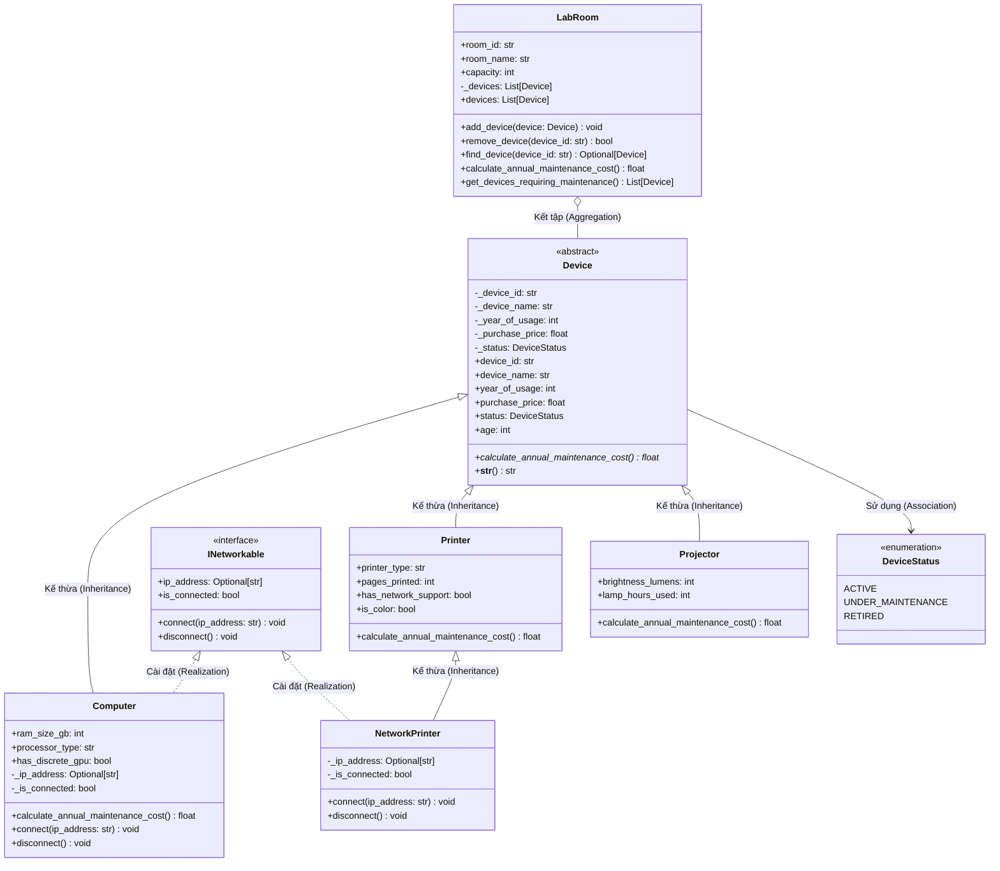

# BÀI THỰC HÀNH TUẦN 05 (LAB W05) - LẬP TRÌNH HƯỚNG ĐỐI TƯỢNG (OOP)
## CHỦ ĐỀ: HỆ THỐNG QUẢN LÝ THIẾT BỊ VÀ HỢP ĐỒNG BẢO TRÌ

[](https://www.python.org/)
[](https://opensource.org/licenses/MIT)

---

### THÔNG TIN SINH VIÊN
- **Họ và tên:** Nguyễn Minh Đức
- **Mã sinh viên:** 202418872
- **Học kỳ:** 2026.1
- **Môn học:** Lập trình hướng đối tượng (OOP)
- **Kho lưu trữ GitHub:** [https://github.com/ngminhduc129/Bai05](https://github.com/ngminhduc129/Bai05)

---

## 1. GIỚI THIỆU BÀI TOÁN

Hệ thống quản lý trang thiết bị phòng thực hành tin học tại trường đại học nhằm giải quyết các bài toán nghiệp vụ:
1. **Phân cấp kế thừa thiết bị:** Quản lý các thiết bị gồm Máy tính (`Computer`), Máy in (`Printer`, `NetworkPrinter`), Máy chiếu (`Projector`) xuất phát từ lớp cơ sở trừu tượng (`Device`).
2. **Dự toán chi phí bảo trì hàng năm:** Mỗi loại thiết bị có cách tính chi phí bảo trì đặc thù dựa trên cấu hình phần cứng, độ hao mòn cơ học và tuổi thọ.
3. **Năng lực kết nối mạng độc lập:** Quản lý khả năng mạng thông qua giao diện `INetworkable`, độc lập với cây kế thừa (máy tính luôn có mạng, chỉ một số máy in có card mạng, máy chiếu không có mạng).
4. **Quản lý phòng thực hành (LabRoom):** Sử dụng quan hệ kết tập (Aggregation) để quản lý danh mục thiết bị trong từng phòng, hỗ trợ tính tổng chi phí bảo trì đa hình và lọc các thiết bị cần đưa đi bảo dưỡng.

---

## 2. CẤU TRÚC THƯ MỤC DỰ ÁN

```text
Bai05/
├── main.py                 # File mã nguồn đơn nhất chứa toàn bộ hệ thống & kiểm thử
├── class_diagram.drawio    # Sơ đồ quan hệ lớp định dạng Draw.io XML
├── BaoCao_Lab_W05.docx     # File báo cáo định dạng Microsoft Word (.docx)
├── BaoCao_Lab_W05.pdf      # File báo cáo định dạng PDF (.pdf)
├── BaoCao_Lab_W05.md       # File báo cáo chi tiết định dạng Markdown
├── BaoCao_Lab_W05.html     # File báo cáo định dạng HTML
├── generate_report.py      # Script tự động xuất báo cáo ra các định dạng
├── generate_drawio.py      # Script tạo file class_diagram.drawio
├── lab w05a.pdf            # Đề bài thực hành gốc
└── README.md               # Tài liệu hướng dẫn dự án
```

---

## 3. THIẾT KẾ HƯỚNG ĐỐI TƯỢNG (OOP)

### 3.1. Danh sách các lớp và Interface

| Tên lớp / Interface | Loại | Mô tả trách nhiệm |
|---|---|---|
| `DeviceStatus` | `Enum` | Định nghĩa 3 trạng thái hoạt động: `Active`, `UnderMaintenance`, `Retired`. |
| `Device` | `Abstract Class` | Lớp cơ sở trừu tượng chứa các thuộc tính dùng chung và định nghĩa phương thức thuần ảo `calculate_annual_maintenance_cost()`. |
| `INetworkable` | `Interface (ABC)` | Giao diện biểu diễn năng lực kết nối mạng (`connect`, `disconnect`, `ip_address`, `is_connected`). |
| `Computer` | `Concrete Class` | Kế thừa `Device` và thực thi `INetworkable`. Quản lý RAM, CPU, GPU rời. |
| `Printer` | `Concrete Class` | Kế thừa `Device`. Đại diện máy in phổ thông kết nối cáp USB (đơn sắc/màu, laser/phun). |
| `NetworkPrinter` | `Concrete Class` | Kế thừa `Printer` và thực thi `INetworkable`. Đại diện máy in văn phòng có card mạng. |
| `Projector` | `Concrete Class` | Kế thừa `Device`. Quản lý độ sáng lumens và số giờ đã dùng bóng đèn. |
| `LabRoom` | `Container Class` | Kết tập danh sách `Device`, quản lý thêm/xóa/tìm kiếm, tính tổng chi phí bảo trì đa hình và lọc bảo trì. |

### 3.2. Sơ đồ quan hệ lớp (Class Diagram)



---

## 4. TRẢ LỜI CÁC CÂU HỎI THIẾT KẾ CỐT LÕI

### 4.1. Vì sao `Device` là lớp trừu tượng?
1. **Mô hình hóa thực tế:** Trong thực tế không tồn tại một thực thể vật lý chỉ là "thiết bị chung chung". Mọi thiết bị được mua về sử dụng đều là đối tượng cụ thể (máy tính, máy in, máy chiếu). Do đó, không cho phép khởi tạo trực tiếp instance `Device()`.
2. **Khuôn mẫu cho Đa hình:** Chi phí bảo trì của mỗi loại thiết bị phụ thuộc vào các tiêu chí phần cứng hoàn toàn khác nhau (GPU rời, số trang in, chế độ màu, số giờ bóng đèn). Lớp cha không thể cung cấp công thức chung hợp lý, vì vậy `calculate_annual_maintenance_cost()` phải là phương thức trừu tượng (`@abstractmethod`) để bắt buộc các lớp con tự định nghĩa logic chi tiết.

### 4.2. Vì sao `INetworkable` là interface?
1. **Tách biệt năng lực hành vi khỏi bản chất thực thể:** Khả năng kết nối mạng là một năng lực hành vi (capability), không phải là bản chất phân loại ("is-a").
2. **Tuân thủ nguyên lý Phân tách Giao diện (ISP):** Máy chiếu và máy in thông thường không hỗ trợ mạng. Nếu đưa phương thức mạng vào `Device`, các lớp con này sẽ bị ép phải kế thừa các hàm vô nghĩa hoặc phải ném ngoại lệ.
3. **Đa hình độc lập cây kế thừa:** Cho phép các thiết bị thuộc nhiều nhánh phân cấp khác nhau (như Máy tính và Máy in mạng) cùng chia sẻ một chuẩn giao tiếp mạng chung.

### 4.3. Tính đa hình được thể hiện ở đâu?
1. **Đa hình phương thức trong `LabRoom.calculate_annual_maintenance_cost()`:** Duyệt danh sách thiết bị `sum(d.calculate_annual_maintenance_cost() for d in self._devices)` mà không dùng `if/isinstance`. Tại runtime, Python tự động gọi chính xác phương thức của lớp con cụ thể (Dynamic Binding/Dispatch).
2. **Đa hình thông qua Interface `INetworkable`:** Các thao tác kết nối, ngắt kết nối và kiểm tra IP được thực hiện đồng nhất trên mọi đối tượng cài đặt `INetworkable` (`Computer`, `NetworkPrinter`) mà không cần quan tâm lớp cụ thể.
3. **Đa hình hiển thị (`__str__`):** Ghi đè phương thức chuỗi của từng lớp con giúp in chi tiết cấu hình đặc thù.

### 4.4. Quan hệ giữa `LabRoom` và `Device` là kết tập hay hợp thành?
- **Là KẾT TẬP (Aggregation):** Vòng đời của `Device` hoàn toàn độc lập với `LabRoom`. Thiết bị có thể tồn tại trong kho khi chưa phân vào phòng; khi phòng thực hành giải thể, thiết bị không bị tiêu hủy mà được chuyển sang phòng khác hoặc đưa đi bảo trì.

### 4.5. Phân tích Trade-off thiết kế máy in mạng
- **Phương án lựa chọn:** Tách lớp `NetworkPrinter` kế thừa từ `Printer` và thực thi `INetworkable`.
- **Trade-off:** Giữ lớp `Printer` thuần khiết, tuân thủ chặt chẽ ISP và LSP. Đổi lại, số lượng lớp tăng lên và nếu muốn nâng cấp phần cứng tại chỗ (cắm card mạng rời vào máy in thường) thì phải thay thế đối tượng thay vì đổi thuộc tính runtime.

---

## 5. HƯỚNG DẪN CHẠY CHƯƠNG TRÌNH

### Yêu cầu môi trường
- Python 3.8+ (khuyên dùng Python 3.10 trở lên)
- Không yêu cầu cài đặt thư viện bên ngoài (sử dụng thư viện chuẩn `abc`, `enum`, `datetime`, `typing`).

### Thực thi chương trình
```bash
# Clone dự án từ GitHub
git clone https://github.com/ngminhduc129/Bai05.git
cd Bai05

# Chạy chương trình kiểm thử chính
python main.py
```

---

## 6. KẾT QUẢ KIỂM THỬ THỰC TẾ

Khi chạy `python main.py`, chương trình sẽ tự động thực hiện 7 thao tác kiểm thử tối thiểu theo yêu cầu đề bài:
1. **Thao tác 1:** Phân bổ các thiết bị vào 2 phòng thực hành (`LAB-101` và `LAB-102`).
2. **Thao tác 2:** Kiểm thử bắt ngoại lệ khi thêm thiết bị trùng mã `PC001` vào phòng.
3. **Thao tác 3:** In danh sách chi tiết các thiết bị trong từng phòng.
4. **Thao tác 4:** Tính tổng chi phí bảo trì dự kiến của từng phòng và toàn trường bằng cơ chế Đa hình:
   - `LAB-101`: **5,400,000 VNĐ** (PC001: 2tr, PR001: 1.36tr, PJ001: 2.04tr)
   - `LAB-102`: **960,000 VNĐ** (PC002: 800k, PR002: 160k)
   - **Tổng toàn trường: 6,360,000 VNĐ**
5. **Thao tác 5:** Lọc và hiển thị danh sách thiết bị cần bảo trì (`UnderMaintenance` hoặc tuổi đời $> 5$ năm).
6. **Thao tác 6:** Cấp phát địa chỉ IP và kết nối mạng cho các thiết bị hỗ trợ `INetworkable`, kiểm thử ngoại lệ khi kết nối lại lúc đang online.
7. **Thao tác 7:** Duyệt danh sách thiết bị mạng thông qua giao diện `INetworkable` độc lập với kiểu lớp cụ thể, kiểm thử ngắt kết nối và giải phóng IP.

---

## 7. LỊCH SỬ COMMIT THEO TỪNG CHỨC NĂNG

Dự án tuân thủ quy trình phát triển lũy tiến và commit rõ ràng:
- `416e0f4`: `feat(core): khoi tao lop truu tuong Device va enum DeviceStatus kem validation`
- `203b3ef`: `feat(network): bo sung interface INetworkable bieu dien nang luc ket noi mang`
- `f7ce616`: `feat(devices): cai dat cac lop dan xuat Computer, Printer, NetworkPrinter, Projector`
- `d537aef`: `feat(room): them lop LabRoom quan ly tap hop thiet bi, da hinh tinh phi bao tri`
- `c097f30`: `feat(main): hoan thien kich ban kiem thu toi thieu 7 thao tac va 5 thiet bi`
- `b3de803`: `docs: bo sung bao cao thuc hanh chi tiet (.md, .docx, .pdf) kem bang chung AI va ket qua kiem thu`
- `add4af7`: `docs: cap nhat duong dan repo Bai05 tren GitHub trong bao cao`
